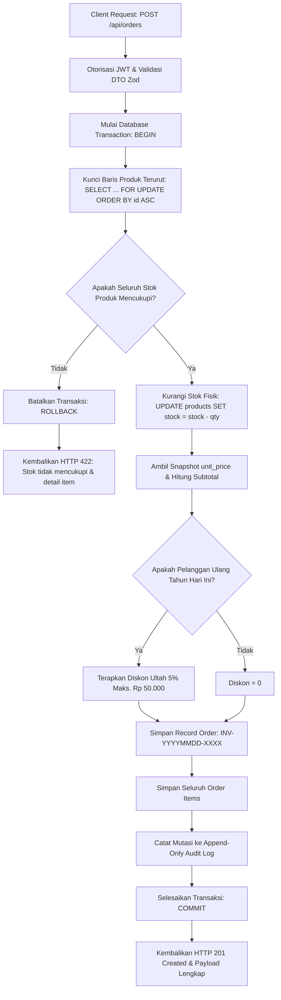

# Titipin — Point of Sale (POS) & Order Management System
### Solusi Technical Test — Medior Fullstack Developer (Azatech)

Aplikasi Point of Sale (POS) dan Order Management modern berskala produksi berbasis **Turborepo** dan **pnpm workspaces**. Proyek ini memisahkan arsitektur menjadi dua service terpisah: **Backend REST API** (NestJS 11+, Drizzle ORM, PostgreSQL 16) dan **Frontend Web Client** (Next.js 15 App Router, React 19, Tailwind CSS).

---

## 1. Pilihan Tech Stack & Alasan Pemilihan

Sesuai ketentuan **Track A (JavaScript / TypeScript)**, tech stack dipilih dengan mempertimbangkan keandalan bisnis, integritas data, dan performa tinggi:

| Lapisan | Teknologi Terpilih | Alasan Pemilihan & Nilai Tambah |
| :--- | :--- | :--- |
| **Runtime** | **Node.js 24 LTS** | Runtime JavaScript modern dengan kestabilan performa I/O tinggi dan dukungan native V8 engine terbaru. |
| **Backend Framework** | **NestJS 11+** | Menyediakan arsitektur modular enterprise (*Clean Architecture*), Dependency Injection terstruktur, *Validation Pipes* deklaratif, serta *Guards* dan *Interceptors* terpusat. |
| **Bahasa** | **TypeScript (Strict Mode)** | Menjamin keamanan tipe (*type safety*) 100% dari backend, shared DTO contracts, hingga frontend UI tanpa celah `any`. |
| **ORM & Database** | **Drizzle ORM & PostgreSQL 16** | *Zero-overhead query builder* dengan kontrol eksplisit atas SQL primitives, sangat esensial untuk mengeksekusi *pessimistic row locking* (`SELECT ... FOR UPDATE`), check constraints (`stock >= 0`), dan rollback transaksi atomik. |
| **Autentikasi** | **JWT (Access + Refresh Token)** | Token access berumur pendek (15 menit) disimpan di memori/header, dilengkapi silent refresh token rotasi (7 hari) via HTTP-only cookie untuk keamanan dari XSS. |
| **Frontend Framework** | **Next.js 15 (App Router) & React 19** | Rendering cepat berbasis komponen modular, layout shell terpadu, dan navigasi client-side instan tanpa reload. |
| **Data Fetching & State** | **TanStack Query v5 & Axios Interceptors** | Manajemen server state otomatis, caching data produk, dan mutex queue saat refresh token expired. |
| **Styling & UI Tokens** | **Tailwind CSS & Lucide React** | Desain responsif (*mobile-first*) dengan efek *frosted glassmorphism*, kepatuhan 100% *zero inline raw SVG* (seluruh ikon resmi `lucide-react`). |
| **Monorepo Tooling** | **Turborepo & pnpm Workspaces** | Eksekusi task pipeline paralel (lint, build, test, typecheck) dengan shared package `@titipin/shared`. |

---

## 2. ⚡ Panduan Quickstart ($\le 6$ Perintah)

Aplikasi dapat dijalankan dari kondisi nol (*fresh clone*) sampai siap digunakan dengan 6 perintah berikut:

```bash
# 1. Clone repository
git clone https://github.com/fprtm/titipin.git && cd titipin

# 2. Inisialisasi berkas konfigurasi environment (.env)
cp .env.example .env && cp apps/backend/.env.example apps/backend/.env && cp apps/frontend/.env.example apps/frontend/.env

# 3. Pasang seluruh dependensi monorepo
pnpm install

# 4. Jalankan kontainer database PostgreSQL 16 lokal
docker compose up -d db

# 5. Jalankan migrasi skema database dan injeksikan data seeder
pnpm db:migrate && pnpm db:seed

# 6. Jalankan service Backend (:3001) dan Frontend (:3000) secara serentak
pnpm dev
```

Aplikasi dan dokumentasi siap diakses di:
- **Frontend App**: [http://localhost:3000](http://localhost:3000)
- **Backend API**: [http://localhost:3001/api](http://localhost:3001/api)
- **Swagger OpenAPI Docs**: [http://localhost:3001/api/docs](http://localhost:3001/api/docs)
- **Prometheus Metrics**: [http://localhost:3001/api/metrics](http://localhost:3001/api/metrics)
- **Prometheus Server**: [http://localhost:9090](http://localhost:9090)
- **Grafana Dashboard UI**: [http://localhost:3002](http://localhost:3002) (Login: `admin` / `Admin123!`)
- **API Health Check**: [http://localhost:3001/api/health](http://localhost:3001/api/health)

---

## 3. 🔑 Kredensial Akun Seeder

Data seeder deterministik (`pnpm db:seed`) menyediakan akun siap pakai:

| Peran (Role) | Email | Kata Sandi | Hak Akses Fitur |
| :--- | :--- | :--- | :--- |
| **Admin** | `admin@titipin.id` | `Admin123!` | Akses penuh: Dashboard Analytics, Manajemen Produk, Pengguna, Audit Trail, & Riwayat Transaksi. |
| **Kasir** | `kasir@titipin.id` | `Kasir123!` | Akses operasional: Terminal Kasir POS, Tahan Transaksi, Pelanggan Member, & Riwayat Transaksi. |

> [!NOTE]
> Seeder juga menginjeksi **25 produk katalog** (termasuk produk dengan stok menipis < 5), **16 pelanggan member**, dan **70 transaksi historis** tersebar sepanjang tahun untuk kelengkapan visual grafik dashboard dan filter riwayat.

---

## 4. 🧠 Logika Bisnis: Pembuatan Order & Anti-Overselling

Alur pembuatan order (`POST /api/orders`) dibangun dengan prinsip **Integritas Finansial & Zero-Overselling**:



### Keunggulan Desain Logika:
1. **Harga & Total Dihitung di Server**: Backend tidak pernah menerima nilai `price`, `subtotal`, atau `total_amount` dari client untuk mencegah manipulasi harga (Price Tampering).
2. **Pessimistic Locking Terurut**: Baris produk dikunci menggunakan `SELECT ... FOR UPDATE` dengan pengurutan ID produk menaik (`ORDER BY id ASC`). Ini menjamin **resistensi deadlock (40P01)** saat terjadi lonjakan transaksi konkuren di kasir berbeda.
3. **Snapshot `unit_price` Abadi**: Harga saat transaksi dibekukan ke tabel `order_items.unit_price`, sehingga jika harga produk di katalog berubah di kemudian hari, laporan keuangan historis tetap 100% akurat.
4. **Resistensi Overselling & Atomik**: Jika salah satu produk dalam keranjang memiliki stok kurang dari yang diminta, seluruh transaksi dibatalkan seketika (`ROLLBACK`), tidak ada stok barang lain yang terpotong, dan response mengembalikan HTTP 422 berformat:
   ```json
   {
     "success": false,
     "message": "Stok tidak mencukupi",
     "errors": {
       "items.0.quantity": ["Stok Aqua Air Mineral 600ml tersisa 2, diminta 5"]
     }
   }
   ```
5. **Pemisahan Tahan Transaksi (Hold Cart)**: Penahanan keranjang kasir dialokasikan ke tabel khusus `draft_orders` (bukan tabel `orders`) tanpa memotong stok fisik gudang, sehingga kasir lain tetap dapat menjual produk tersebut.

---

## 5. 🧪 Panduan Menjalankan Automated Tests & Benchmark

Aplikasi dilengkapi dengan **287 skenario pengujian otomatis** (198 Backend Integration, RBAC, & Concurrency Tests + 89 Frontend Unit & Component Tests) serta modul pengujian beban (*concurrency stress benchmark*):

```bash
# Menjalankan seluruh test suite monorepo
pnpm test

# Menjalankan test suite backend saja (NestJS + Supertest)
pnpm --filter @titipin/backend test

# Menjalankan test suite frontend saja (Vitest + React Testing Library)
pnpm --filter @titipin/frontend test

# Menjalankan benchmark beban konkuren (30 checkout bersamaan, verifikasi 0 overselling & p95 latensi)
pnpm benchmark

# Menjalankan linting standar ESLint 9 Flat Config
pnpm lint

# Menjalankan validasi TypeScript tanpa kompilasi
pnpm typecheck

# Menjalankan audit kepatuhan monorepo (Zero raw SVG, Lint, Typecheck, Test)
pnpm audit:quality

# Menjalankan verifikasi keutuhan seluruh tautan dokumentasi markdown
pnpm audit:links
```

---

## 6. 🎁 Pemenuhan Fitur Bonus (Menambah Nilai)

Seluruh poin bonus opsional dari lembar penilaian telah diimplementasikan:

- [x] **Docker Compose Multi-Container Orchestration**: Tersedia berkas `docker-compose.prod.yml` untuk menjalankan backend, frontend, dan database sekaligus via `docker compose -f docker-compose.prod.yml up --build`.
- [x] **Continuous Integration (GitHub Actions)**: Disediakan pipeline CI otomatis di `.github/workflows/ci.yml` yang memverifikasi lint, typecheck, migrasi, dan automated test suites pada setiap push/PR.
- [x] **Grafik Penjualan Harian**: Visualisasi tren penjualan harian di modul `/dashboard` dengan interaktivitas tooltip, filter rentang tanggal, dan kartu metrik analitik.
- [x] **Ekspor Riwayat Order ke Multi-Sheet Excel**: Tombol "Ekspor Excel" di `/orders` menghasilkan file `.xlsx` biner (Sheet 1: Rekap Transaksi & Omset berformat IDR, Sheet 2: Rincian Produk Terjual).
- [x] **Automated Tests di Sisi Frontend**: 89 pengujian Vitest + React Testing Library mencakup alur kasir POS, keyboard shortcuts (F2, F8, F9, Esc), toggle ukuran struk thermal 58mm/80mm, Global Toast Provider, dan modal diff viewer.
- [x] **Sales Analytics & Business Intelligence Dashboard**: Halaman khusus `/analytics` dengan visualisasi tren penjualan dual-axis Recharts (area omset Rupiah dan garis volume pesanan), Market Basket Analysis untuk rekomendasi bundling kombo produk, analisis jam belanja sibuk 24 jam (*peak shopping hours*), dan segmentasi kontribusi omset member vs *walk-in*.
- [x] **Akselerasi Query GIN Trigram (`pg_trgm`)**: Mengaktifkan ekstensi PostgreSQL `pg_trgm` dan 5 indeks GIN Trigram pada produk, pelanggan, dan pesanan, mengubah pencarian parsial dari sequential scan lambat menjadi index bitmap scan instan.
- [x] **Observabilitas Produksi & Prometheus Scraper**: Endpoint Prometheus di `/api/metrics` (`prom-client`), latency tracker interceptor (`X-Response-Time` header & slow request alert $>100\text{ms}$), dan endpoint status kesehatan sistem `/api/health`.
- [x] **Dokumentasi Interaktif OpenAPI (Swagger)**: Swagger UI interaktif di `/api/docs` dengan otorisasi JWT Bearer langsung dari browser, JSON spec di `/api/docs-json`, file OpenAPI YAML, dan Postman Collection.
- [x] **Stress Testing Concurrency & Zero-Overselling**: Skrip benchmark otomatis (`pnpm benchmark`) yang menguji 30 checkout bersamaan pada stok terbatas dengan 0 overselling, tanpa deadlock connection pool, dan throughput $\approx 278\text{ req/sec}$.

---

## 7. 🔮 Asumsi, Keterbatasan, & Rencana Pengembangan Lanjutan

### Asumsi Sistem Saat Ini:
- Sistem diasumsikan beroperasi pada model toko tunggal (*single-outlet retail / standalone store*).
- Metode pembayaran utama adalah tunai (*Cash*) dengan kalkulasi kembalian otomatis dan konfirmasi nominal pembayaran.

### Keterbatasan & Rencana Peningkatan:
1. **Multi-Outlet & Multi-Warehouse**: Mendukung pencatatan stok per cabang/gudang dan transfer stok antar cabang (*stock transfer order*).
2. **Integrasi Payment Gateway Digital**: Menambahkan integrasi dinamis QRIS (Midtrans / Xendit) dengan webhook listener terverifikasi signature HMAC.
3. **Hardware Direct ESC/POS Driver**: Menghubungkan printer thermal kasir via Web Bluetooth / WebUSB API untuk cetak instan tanpa membuka dialog print bawaan browser.
4. **Asynchronous Background Processing**: Mengadopsi Redis dan BullMQ untuk pemrosesan ekspor dataset masif (ribuan transaksi) dan pengiriman email receipt otomatis.

---

## 8. 🤖 AI Usage Disclosure

Sesuai ketentuan pengerjaan pada Halaman 6 dokumen Technical Test:

- **Tools yang Digunakan**: Google Antigravity & Google Gemini.
- **Bagian Penggunaan**:
  1. *Brainstorming & Eksplorasi Tahap Awal*: Menggunakan Google Gemini untuk brainstorming ide fitur, pemetaan kebutuhan sistem POS ritel, perumusan alur bisnis anti-overselling, serta eksplorasi skenario pengujian edge-case.
  2. *Perancangan Skema Monorepo & Kontrak Tipe*: Membantu penataan struktur pnpm workspaces dan `@titipin/shared` DTO schemas.
  3. *Pembuatan Dataset Seeder*: Membantu merumuskan variasi 25 produk retail Indonesia dan 70 transaksi historis realistis.
  4. *Generasi Test Cases Concurrency & Stress*: Membantu menyusun skenario kompetisi race condition paralel concurrent checkout requests pada unit test dan stress benchmark.
- **Tanggung Jawab Teknis**: Seluruh arsitektur, implementasi transaksi atomik, isolasi repositori, validasi, dan styling antarmuka dipahami, dikontrol, serta siap dijelaskan secara mendalam oleh kandidat dalam sesi technical review.

---

## 9. 📖 Dokumentasi Arsitektur, Desain, & Spesifikasi Produk

- **Interactive Swagger UI**: Dapat langsung dijelajahi dan diuji di peramban web pada [http://localhost:3001/api/docs](http://localhost:3001/api/docs) lengkap dengan fitur *Authorize* JWT Bearer Token.
- **Spesifikasi OpenAPI 3.0 / 3.1**: Tersedia via endpoint JSON di [http://localhost:3001/api/docs-json](http://localhost:3001/api/docs-json) serta berkas statis di [docs/api/openapi.yaml](docs/api/openapi.yaml).
- **Prometheus Metrics Scraper Endpoint**: Tersedia di [http://localhost:3001/api/metrics](http://localhost:3001/api/metrics).
- **Prometheus Server UI**: Tersedia di [http://localhost:9090](http://localhost:9090) untuk inspeksi query TSDB dan status target scrape.
- **Grafana Observability Dashboard**: Tersedia di [http://localhost:3002](http://localhost:3002) (Login: `admin` / `Admin123!`) dengan dashboard visualisasi performa real-time.
- **Postman Collection**: Berkas koleksi JSON siap impor tersedia di [docs/api/titipin_postman_collection.json](docs/api/titipin_postman_collection.json).
- **Arsitektur Sistem**: [docs/architecture/ARCHITECTURE.md](docs/architecture/ARCHITECTURE.md).
- **Model Data Relasional**: [docs/architecture/DATA-MODEL.md](docs/architecture/DATA-MODEL.md).
- **Spesifikasi Fondasi Sistem**: [docs/architecture/FOUNDATION.md](docs/architecture/FOUNDATION.md).
- **Architecture Decision Records (ADRs)**:
  - [ADR-001: Modular Monolith Architecture](docs/architecture/ADR/ADR-001-modular-monolith.md)
  - [ADR-002: Drizzle ORM Engine](docs/architecture/ADR/ADR-002-drizzle-orm.md)
  - [ADR-003: pnpm Workspaces & Turborepo](docs/architecture/ADR/ADR-003-pnpm-monorepo.md)
  - [ADR-004: Dual-Token Custom Auth](docs/architecture/ADR/ADR-004-dual-token-custom-auth.md)
  - [ADR-005: POS Draft Orders Isolation](docs/architecture/ADR/ADR-005-pos-draft-orders-isolation.md)
  - [ADR-006: Dual Logging Strategy](docs/architecture/ADR/ADR-006-dual-logging-strategy.md)
  - [ADR-007: Sales Analytics & Business Intelligence](docs/architecture/ADR/ADR-007-sales-analytics-and-business-intelligence.md)
  - [ADR-008: PostgreSQL Trigram & Prometheus Observability](docs/architecture/ADR/ADR-008-postgresql-trigram-and-prometheus-observability.md)
- **Product Requirements Document (PRD)**: [docs/product/PRD.md](docs/product/PRD.md).
- **Kriteria Keberterimaan (Acceptance Criteria)**: [docs/product/ACCEPTANCE-CRITERIA.md](docs/product/ACCEPTANCE-CRITERIA.md).
- **Skenario & User Stories**: [docs/product/USER-STORIES.md](docs/product/USER-STORIES.md).
- **Master Sprint Tickets**: [docs/planning/TICKETS.md](docs/planning/TICKETS.md).
- **Sprint Implementation Roadmap**: [docs/planning/SPRINT-PLAN.md](docs/planning/SPRINT-PLAN.md).
- **Spesifikasi Halaman Analitik UI**: [docs/design/pages/11-analytics.md](docs/design/pages/11-analytics.md).
