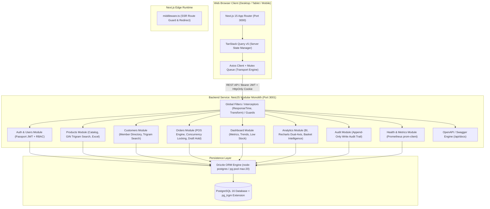
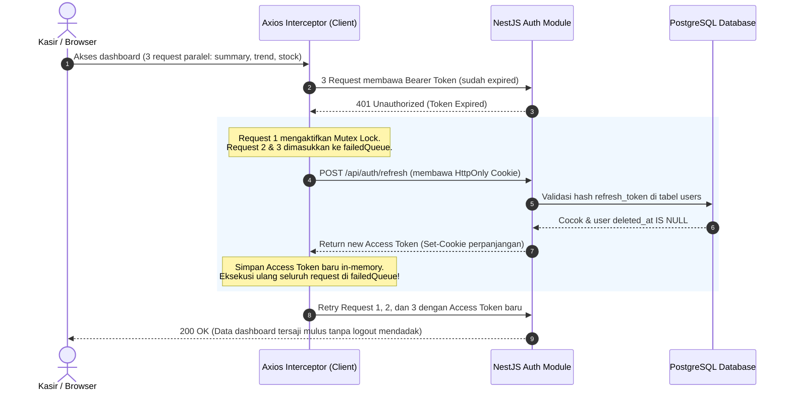
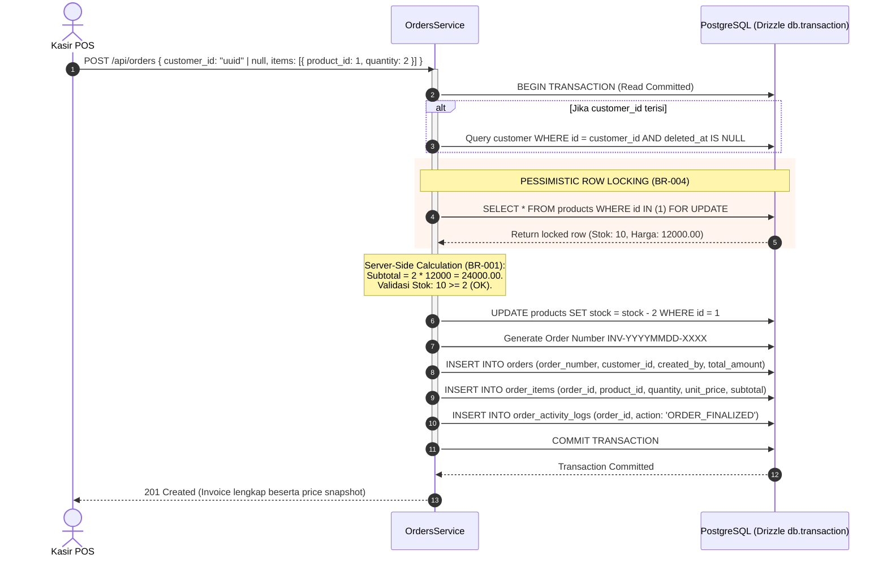
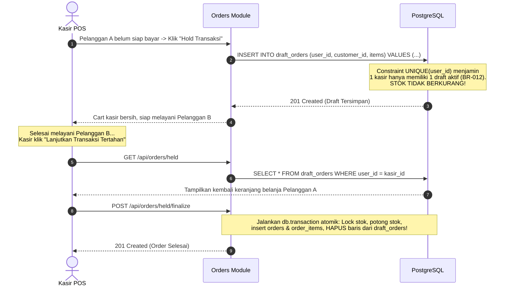

# SYSTEM ARCHITECTURE & TECHNICAL SPECIFICATION
## Titipin — Sistem Point of Sale (POS) & Order Management

| Metadata | Keterangan |
| :--- | :--- |
| **Dokumen ID** | `ARCH-TITIPIN-001` |
| **Versi** | `1.0.0` |
| **Tanggal Efektif** | 27 Oktober 2026 |
| **Status** | APPROVED FOR IMPLEMENTATION |
| **Pola Arsitektur** | Modular Monolith (Backend) + Feature-Driven Colocation (Frontend) |
| **Monorepo Engine** | pnpm Workspaces |
| **Dokumen Acuan** | `docs/product/PRD.md`, `docs/architecture/DATA-MODEL.md`, `docs/architecture/ADR/` |

---

## 1. GAMBARAN UMUM SISTEM (HIGH-LEVEL ARCHITECTURE)

Titipin POS dirancang dengan arsitektur **dua service terpisah** yang terorganisir di dalam sebuah **pnpm Monorepo**:



---

## 2. STRUKTUR WORKSPACE MONOREPO (`pnpm-workspaces`)

```
titipin/
├── apps/
│   ├── backend/                     # Service 1: NestJS 11+ / Node.js 24 LTS REST API
│   │   ├── src/
│   │   │   ├── common/              # Decorators, Filters, Guards, Interceptors
│   │   │   ├── config/              # Environment config validation (Zod)
│   │   │   ├── database/            # Drizzle connection pool provider & schema definitions
│   │   │   │   ├── schema/          # Modular Drizzle Schema per domain
│   │   │   │   │   ├── users.schema.ts
│   │   │   │   │   ├── products.schema.ts
│   │   │   │   │   ├── customers.schema.ts
│   │   │   │   │   ├── orders.schema.ts
│   │   │   │   │   ├── audit.schema.ts
│   │   │   │   │   └── index.ts     # Central schema barrel file
│   │   │   │   ├── migrate.ts       # Programmatic migration runner
│   │   │   │   └── seed.ts          # Database seeder (Admin, Cashier, Products, Orders)
│   │   │   ├── modules/             # Modular Monolith Bounded Contexts
│   │   │   │   ├── auth/            # Login, Refresh, Logout, Change Password
│   │   │   │   ├── users/           # User listing, Admin Reset Password, Soft Delete
│   │   │   │   ├── products/        # Product CRUD, Soft Delete, GIN Trigram Search, Excel Export
│   │   │   │   ├── customers/       # Customer/Member CRUD & Soft Delete, Trigram Search
│   │   │   │   ├── orders/          # POS Engine, Row Locking, Hold Draft, History, Atomic Audit
│   │   │   │   ├── dashboard/       # Daily/Monthly/Quarterly Summary, Trends, Low Stock
│   │   │   │   ├── analytics/       # Business Intelligence, Recharts Dual-Axis, Basket Affinity
│   │   │   │   ├── audit/           # Write Audit Trail Interceptor & Admin Query
│   │   │   │   └── health/          # Health Check (/api/health) & Prometheus (/api/metrics)
│   │   │   ├── scripts/             # CLI Scripts (benchmark-concurrency, generate-openapi)
│   │   │   ├── app.module.ts        # Root Module
│   │   │   └── main.ts              # Entry point bootstrap (Swagger UI, ResponseTimeInterceptor)
│   │   ├── test/                    # Automated Integration Tests (Vitest + Supertest)
│   │   ├── drizzle.config.ts        # Drizzle Kit configuration
│   │   ├── Dockerfile               # Multi-stage Docker build backend
│   │   └── package.json
│   │
│   └── frontend/                    # Service 2: Next.js 15 App Router / React 19 Client
│       ├── src/
│       │   ├── app/                 # Thin Layout & Routing Shell
│       │   │   ├── (auth)/login/    # Page login
│       │   │   ├── (dashboard)/     # Authenticated shell layout (Navbar, Sidebar)
│       │   │   │   ├── dashboard/   # Dashboard analytics view
│       │   │   │   ├── analytics/   # Full-page Sales BI Analytics (Admin only)
│       │   │   │   ├── pos/         # Cashier POS Interface & Keyboard Shortcuts
│       │   │   │   ├── products/    # Product catalog, import, export
│       │   │   │   ├── customers/   # Member management
│       │   │   │   ├── orders/      # POS Transaction history & detail
│       │   │   │   ├── users/       # User management (Admin only)
│       │   │   │   └── audit-logs/  # Audit trail viewer (Admin only)
│       │   │   └── layout.tsx       # Root layout (QueryClientProvider + Toasters)
│       │   ├── features/            # Feature-Driven Colocated Modules
│       │   │   ├── auth/            # api, hooks, components
│       │   │   ├── products/        # api, hooks, components, import-dialog
│       │   │   ├── customers/       # api, hooks, components
│       │   │   ├── orders/          # api, hooks, pos-cart, hold-modal, invoice
│       │   │   ├── dashboard/       # api, hooks, trend-chart, metric-cards
│       │   │   ├── users/           # api, hooks, reset-modal
│       │   │   └── audit/           # api, hooks, audit-table
│       │   ├── components/ui/       # Dumb presentational components (shadcn/ui primitives)
│       │   ├── lib/                 # Axios client instance, formatters, utilities
│       │   └── middleware.ts        # Next.js Edge SSR Route Guard
│       ├── Dockerfile               # Standalone Next.js Docker build
│       └── package.json
│
├── packages/
│   └── shared/                      # Shared Contracts & Enums
│       ├── src/
│       │   ├── enums/               # Role ('ADMIN' | 'CASHIER'), Gender ('Pria' | 'Wanita')
│       │   ├── types/               # User, Product, Customer, Order, ApiResponse interfaces
│       │   └── schemas/             # Shared Zod validation schemas
│       └── package.json
│
├── docker-compose.yml               # Local Development (PostgreSQL DB)
├── docker-compose.prod.yml          # Production Orchestration (Backend + Frontend + DB)
├── pnpm-workspace.yaml              # pnpm workspace definition
└── README.md                        # Master Documentation & Setup Guide
```

---

## 3. DATA BOUNDARIES & MODULAR MONOLITH DESIGN

Setiap modul di `apps/backend/src/modules/` mengisolasi tanggung jawabnya secara tegas:

| Modul Domain | Tabel yang Dikelola | Hak Akses (*Role Permission*) | Tanggung Jawab Utama |
| :--- | :--- | :--- | :--- |
| **`auth`** | `users` (baca/update hash) | Public (`login`, `refresh`), Authenticated (`logout`, `me`, `change-password`) | Verifikasi kredensial, penerbitan JWT, pencabutan token. |
| **`users`** | `users` (CRUD) | `ADMIN` Only (`BR-011`, `BR-015`) | Listing user, reset password kasir, penonaktifan akun (soft delete). |
| **`products`** | `products` | Read: Kasir & Admin; Write: Admin Only | Katalog produk, validasi harga/stok, ekspor/impor Excel idempoten. |
| **`customers`** | `customers` | Read & Create: Kasir & Admin; Update/Delete: Admin | Profil pelanggan/member toko. |
| **`orders`** | `orders`, `order_items`, `draft_orders`, `order_activity_logs` | Kasir & Admin | Engine POS, row locking concurrency, hold draft, invoice detail. |
| **`dashboard`** | Agregasi `orders`, `order_items`, `products` | Kasir & Admin | Metrik omset harian/bulanan/kuartalan, grafik tren, produk terlaris & lesu. |
| **`analytics`** | Agregasi `orders`, `order_items`, `customers` | `ADMIN` Only | Business Intelligence, Recharts multi-axis, Market Basket Analysis, dan rekomendasi kombo bundling. |
| **`audit`** | `audit_logs` | Write: System Hook; Read: `ADMIN` Only | Pencatatan append-only seluruh mutasi data write sistem. |
| **`health`** | Status DB connection pool & Node process | Public & Prometheus Scraper | Health check probe (`/api/health`) dan eksposisi metrik standar (`/api/metrics`). |

### 3.1 Aturan Batas Antarmodul & Integritas Transaksi (*Encapsulation Rules*)

Untuk mencegah modular monolith terdegradasi menjadi "spaghetti code", sistem memberlakukan aturan keras (*strict rules*):
1. **Dilarang Mutasi Lintas Tabel Langsung**: Modul `orders` dilarang mengimpor tabel `products` untuk melakukan update langsung (`UPDATE products SET stock = ...`).
2. **Delegasi Melalui Exported Service**: Operasi yang melintasi domain bisnis wajib didelegasikan ke NestJS Service resmi milik modul terkait (misal: `OrdersService` memanggil `ProductsService.lockAndDeductStock(tx, items)`).
3. **Penerusan Context Transaksi (`tx`)**: Seluruh interaksi lintas-service dalam satu atomic operation wajib menerima instance transaksi Drizzle (`tx`) yang sama, memastikan prinsip ACID (All-or-Nothing).
4. **Isolasi Schema**: Meskipun tabel didefinisikan secara modular di `database/schema/*.schema.ts` untuk keperluan migration engine Drizzle Kit dan relasi foreign key DB, hak mutasi tabel berada 100% di bawah wewenang modul domain pemiliknya.

---

## 4. SEQUENCE DIAGRAMS (ALUR BISNIS UTAMA)

### 4.1 Autentikasi & Silent Mutex Auto-Refresh Token
Menunjukkan bagaimana sistem kebal dari serangan XSS dan kebal terhadap *race condition* saat token kadaluarsa di tengah request paralel:



---

### 4.2 Pembuatan Order POS Bebas Race Condition via Pessimistic Row Locking
Menunjukkan bagaimana transaksi atomik (*All-or-Nothing*) dan penguncian baris mencegah *overselling*:



---

### 4.3 Alur Hold Transaksi POS (`draft_orders`)
Menunjukkan bagaimana kasir menahan antrean pelanggan tanpa memotong stok barang fisik:



---

## 5. ARSITEKTUR KEAMANAN & AUTHORIZATION (RBAC)

1. **Dual Token Lifecycle (`BR-007`):**
   - **Access Token:** Berumur 15 menit, disimpan *in-memory* di frontend.
   - **Refresh Token:** Berumur 7 hari, disimpan di cookie dengan atribut: `HttpOnly; SameSite=Strict; Path=/api/auth/refresh`. Di lingkungan production, flag `Secure` otomatis aktif.
2. **Role-Based Access Control (`BR-015`):**
   - Token JWT memuat claim `role` (`'ADMIN'` atau `'CASHIER'`).
   - Handler controller backend menggunakan decorator `@Roles('ADMIN')` yang dievaluasi oleh `RolesGuard`.
   - Endpoint terproteksi Admin:
     - `/api/users/*` (User Management)
     - `/api/audit-logs/*` (Audit Trail)
     - `POST/PUT/DELETE /api/products/*` (Katalog Write)
     - `DELETE /api/customers/*` (Customer Deletion)
   - Percobaan akses oleh user dengan role `CASHIER` langsung ditolak dengan **HTTP 403 Forbidden**.
3. **SSR Protection via Next.js Edge Middleware:**
   - Middleware mengecek keberadaan session cookie sebelum merender halaman `/dashboard/*`.
   - Jika belum login, request diarahkan langsung ke `/login` di level SSR tanpa *flash of unauthenticated content* (zero-FOUC).
4. **Cross-Origin Resource Sharing (CORS) Policy:**
   - Karena backend (`:3001`) dan frontend (`:3000`) merupakan dua service terpisah, NestJS mengonfigurasi CORS dengan `credentials: true` dan origin eksplisit (`http://localhost:3000` atau domain production). Nilai wildcard `*` dilarang keras agar browser mengizinkan pengiriman cookie `refresh_token`.
5. **Rate Limiting & Proteksi Brute-Force:**
   - Modul `auth` diproteksi oleh `@nestjs/throttler` dengan batas maksimal 10 request per menit per alamat IP pada rute `POST /api/auth/login`. Pelanggaran batas memicu respon **HTTP 429 Too Many Requests**.
6. **Layanan Pemantauan & Healthcheck Kontainer (`GET /api/health`):**
   - Menyediakan endpoint non-terproteksi untuk pemantauan ketersediaan sistem dan konektivitas pool database oleh Docker Compose (`healthcheck.test`). Mengembalikan status `200 OK` jika DB terhubung, atau `503 Service Unavailable` jika koneksi DB terputus.

---

## 6. SIKLUS PERUBAHAN DATABASE & MIGRATION STRATEGY

Pengelolaan skema database dikendalikan sepenuhnya oleh **Drizzle Kit**:
1. **Deklarasi Kode:** Skema diperbarui di `packages/database/src/schema.ts` atau `apps/backend/src/database/schema.ts`.
2. **Generasi Migrasi SQL:** Developer menjalankan `pnpm db:generate`. Drizzle Kit membaca perbedaan TypeScript schema terhadap histori migrasi dan menghasilkan berkas migrasi SQL berurutan di `drizzle/XXXX_migration_name.sql`.
3. **Eksekusi Migrasi Terprogram:**
   - Script runner `migrate.ts` menggunakan method `migrate(db, { migrationsFolder: './drizzle' })`.
   - Script ini dipanggil otomatis sebelum aplikasi dijalankan (`pnpm db:migrate`) dan di dalam setup docker-compose.
4. **Seeder Data Awal (`pnpm db:seed`):**
   - Menghasilkan 1 Admin (`admin@titipin.id`), 1 Kasir (`kasir@titipin.id`).
   - Minimal 20 produk bervariasi (termasuk beberapa produk dengan stok $<5$).
   - Minimal 15 pelanggan terdaftar (member).
   - Minimal 30 order transaksi historis yang tersebar realistis dalam 30 hari terakhir.

---

## 7. ORKESTRASI SETUP LOKAL & PRODUCTION (MAKSIMAL 6 PERINTAH)

Sistem memenuhi **NFR-DEV-01** (dapat dijalankan dari database kosong hingga berjalan penuh dalam $\le 6$ perintah CLI):

### 7.1 Setup Lingkungan Lokal (Development)
```bash
# 1. Masuk ke direktori proyek
cd titipin

# 2. Siapkan berkas environment
cp .env.example .env

# 3. Jalankan container PostgreSQL
docker compose up -d db

# 4. Install seluruh dependensi monorepo
pnpm install

# 5. Jalankan migrasi skema dan seeder database awal
pnpm db:migrate && pnpm db:seed

# 6. Jalankan aplikasi secara bersamaan (Backend: 3001, Frontend: 3000)
pnpm dev
```

### 7.2 Menjalankan Automated Integration Test Suite
```bash
pnpm test
```
*Mengeksekusi 9 skenario integrasi wajib (`TEST-01` s/d `TEST-09`) menggunakan Vitest/Jest + Supertest pada database PostgreSQL uji.*

### 7.3 Setup Lingkungan Production (Docker Compose Full Stack)
```bash
docker compose -f docker-compose.prod.yml up -d --build
```
*Mengompilasi multi-stage build backend Node.js dan standalone Next.js frontend, menghubungkannya ke jaringan internal PostgreSQL.*
