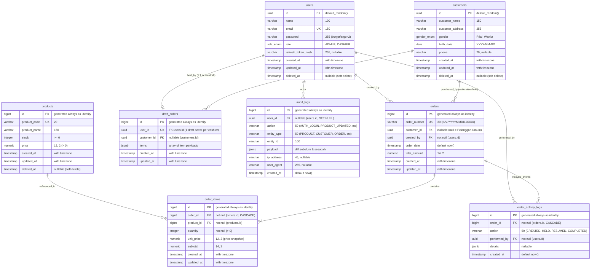

# DATA MODEL & DATABASE DESIGN
## Titipin — Sistem Point of Sale (POS) & Order Management

| Metadata | Keterangan |
| :--- | :--- |
| **Dokumen ID** | `DATA-MODEL-TITIPIN-001` |
| **Versi** | `1.0.0` |
| **Status** | APPROVED FOR IMPLEMENTATION |
| **Database Engine** | PostgreSQL 16+ |
| **ORM / Migration** | Drizzle ORM (`drizzle-orm/node-postgres`) + Drizzle Kit |
| **Acuan Bisnis** | `docs/product/PRD.md`, `docs/product/ACCEPTANCE-CRITERIA.md` |

---

## 1. PENDAHULUAN & PRINSIP DATA MODELING

Desain basis data pada **Titipin POS** memprioritaskan:
1. **Integritas Finansial Moneter Mutlak:** Menggunakan tipe data SQL `numeric(12,2)` untuk harga produk dan snapshot harga satuan, serta `numeric(14,2)` untuk total order, mengeliminasi galat pembulatan floating-point (*IEEE-754*).
2. **Kekebalan terhadap Perubahan Historis (*Price Snapshotting*):** Nilai `order_items.unit_price` dan `order_items.subtotal` mencatat harga saat transaksi terjadi. Perubahan harga master pada `products.price` di masa depan tidak mengubah transaksi lampau (`BR-002`).
3. **Pemisahan Draft vs Transaksi Final (*Isolation Principle*):** Transaksi yang sedang di-hold disimpan di tabel terpisah `draft_orders` (`BR-016`), sehingga tabel `orders` murni merepresentasikan transaksi yang telah berstatus *completed*.
4. **Audit Trail & Dual Logging:** Memisahkan log sistem `audit_logs` (append-only, mencatat seluruh aksi *write* pengguna) dari log siklus hidup transaksi `order_activity_logs` (`BR-017`).
5. **Dukungan Pelanggan Umum (*Walk-in Support*):** Kolom `orders.customer_id` bernilai `nullable`, memfasilitasi transaksi tanpa memilih pelanggan terdaftar (`BR-013`).
6. **Zero-Overhead BigInt Serialization di Node.js:** Seluruh kolom `bigint` didefinisikan menggunakan opsi Drizzle `{ mode: 'number' }`, secara alami menyelesaikan potensi galat `TypeError: Do not know how to serialize a BigInt` saat serialisasi JSON.

---

## 2. ENTITY RELATIONSHIP DIAGRAM (ERD)



---

## 3. DATA DICTIONARY LENGKAP

### 3.1 Tabel `users`
Menyimpan akun operator sistem internal (Admin dan Kasir) yang memiliki hak akses login.

| Nama Kolom | Tipe Data | Nullable | Default | Keterangan & Aturan Bisnis |
| :--- | :--- | :--- | :--- | :--- |
| `id` | `uuid` | No | `gen_random_uuid()` | Primary Key unik akun pengguna. |
| `name` | `varchar(100)` | No | - | Nama lengkap staf/admin. |
| `email` | `varchar(150)` | No | - | Alamat email unik untuk login (`UNIQUE`). |
| `password` | `varchar(255)` | No | - | Hash password (`bcrypt` cost 10 atau `argon2id`). |
| `role` | `enum('ADMIN', 'CASHIER')` | No | `'CASHIER'` | Hak akses pengguna (`BR-015`). |
| `refresh_token_hash` | `varchar(255)` | Yes | `NULL` | Hash dari refresh token aktif untuk stateful revocation (`BR-008`). |
| `created_at` | `timestamptz` | No | `NOW()` | Timestamp pembuatan akun. |
| `updated_at` | `timestamptz` | No | `NOW()` | Timestamp pembaharuan akun. |
| `deleted_at` | `timestamptz` | Yes | `NULL` | Timestamp penonaktifan akun (`BR-010`). Non-null = diblokir dari login. |

* **Index:** `users_email_idx` (`UNIQUE btree (email)`).

---

### 3.2 Tabel `products`
Menyimpan katalog produk barang dagangan toko.

| Nama Kolom | Tipe Data | Nullable | Default | Keterangan & Aturan Bisnis |
| :--- | :--- | :--- | :--- | :--- |
| `id` | `bigint` | No | `IDENTITY` | Primary Key auto-increment. Serialized as `number`. |
| `product_code` | `varchar(20)` | No | - | Kode SKU/Barcode unik (`UNIQUE`, misal: `P0001`). Natural key untuk import idempoten (`BR-009`). |
| `product_name` | `varchar(150)` | No | - | Nama lengkap produk barang. |
| `stock` | `integer` | No | `0` | Sisa kuantitas barang fisik di toko. Wajib $\ge 0$. |
| `price` | `numeric(12,2)` | No | - | Harga jual satuan terkini dalam Rupiah. Wajib $> 0$. |
| `created_at` | `timestamptz` | No | `NOW()` | Timestamp pendaftaran produk. |
| `updated_at` | `timestamptz` | No | `NOW()` | Timestamp modifikasi data/stok produk. |
| `deleted_at` | `timestamptz` | Yes | `NULL` | Soft delete (`BR-006`). Dikecualikan dari katalog order baru. |

* **Index:**
  - `products_product_code_idx` (`UNIQUE btree (product_code)`).
  - `idx_products_search` (`btree (product_name, product_code)`).
* **Check Constraints:**
  - `check_stock_non_negative`: `CHECK (stock >= 0)`
  - `check_price_positive`: `CHECK (price > 0)`

---

### 3.3 Tabel `customers`
Menyimpan data identitas pelanggan terdaftar (member).

| Nama Kolom | Tipe Data | Nullable | Default | Keterangan & Aturan Bisnis |
| :--- | :--- | :--- | :--- | :--- |
| `id` | `uuid` | No | `gen_random_uuid()` | Primary Key unik profil pelanggan/member. |
| `customer_name` | `varchar(150)` | No | - | Nama lengkap pelanggan. |
| `customer_address` | `varchar(255)` | No | - | Alamat tempat tinggal / pengiriman pelanggan. |
| `gender` | `enum('Pria', 'Wanita')` | No | - | Klasifikasi jenis kelamin pelanggan. |
| `birth_date` | `date` | No | - | Tanggal lahir (`YYYY-MM-DD`). |
| `phone` | `varchar(20)` | Yes | `NULL` | Nomor handphone/kontak WhatsApp. |
| `created_at` | `timestamptz` | No | `NOW()` | Timestamp pendaftaran member. |
| `updated_at` | `timestamptz` | No | `NOW()` | Timestamp pembaharuan profil member. |
| `deleted_at` | `timestamptz` | Yes | `NULL` | Soft delete (`BR-006`). |

* **Index:** `idx_customers_name` (`btree (customer_name)`).

---

### 3.4 Tabel `orders`
Menyimpan transaksi penjualan POS yang telah **selesai (*COMPLETED*)**.

| Nama Kolom | Tipe Data | Nullable | Default | Keterangan & Aturan Bisnis |
| :--- | :--- | :--- | :--- | :--- |
| `id` | `bigint` | No | `IDENTITY` | Primary Key transaksi. Serialized as `number`. |
| `order_number` | `varchar(30)` | No | - | Nomor invoice unik dengan format `INV-YYYYMMDD-XXXX` (`BR-005`). |
| `customer_id` | `uuid` | **Yes** | `NULL` | Foreign Key ke `customers.id`. **NULL jika pelanggan umum (walk-in)** (`BR-013`). |
| `created_by` | `uuid` | No | - | Foreign Key ke `users.id` (kasir yang memproses order). |
| `order_date` | `timestamptz` | No | `NOW()` | Tanggal dan waktu transaksi diselesaikan. |
| `total_amount` | `numeric(14,2)` | No | - | Akumulasi total nilai belanja yang dihitung di backend (`BR-001`). |
| `created_at` | `timestamptz` | No | `NOW()` | Timestamp pembuatan baris record. |
| `updated_at` | `timestamptz` | No | `NOW()` | Timestamp pembaruan baris record. |

* **Index:**
  - `orders_order_number_idx` (`UNIQUE btree (order_number)`).
  - `idx_orders_customer_date` (`btree (customer_id, order_date)`).
  - `idx_orders_created_by` (`btree (created_by)`).
  - `idx_orders_date` (`btree (order_date)`).

---

### 3.5 Tabel `order_items`
Menyimpan rincian produk yang dibeli beserta **snapshot harga satuan historis**.

| Nama Kolom | Tipe Data | Nullable | Default | Keterangan & Aturan Bisnis |
| :--- | :--- | :--- | :--- | :--- |
| `id` | `bigint` | No | `IDENTITY` | Primary Key item order. Serialized as `number`. |
| `order_id` | `bigint` | No | - | Foreign Key ke `orders.id` (`ON DELETE CASCADE`). |
| `product_id` | `bigint` | No | - | Foreign Key ke `products.id`. |
| `quantity` | `integer` | No | - | Jumlah unit barang yang dibeli ($> 0$). |
| `unit_price` | `numeric(12,2)` | No | - | **Snapshot harga master produk** saat transaksi dibuat (`BR-002`). |
| `subtotal` | `numeric(14,2)` | No | - | Hasil kalkulasi moneter server ($quantity \times unit\_price$). |
| `created_at` | `timestamptz` | No | `NOW()` | Timestamp pencatatan item. |
| `updated_at` | `timestamptz` | No | `NOW()` | Timestamp pembaruan item. |

* **Index:**
  - `idx_order_items_order_id` (`btree (order_id)`).
  - `idx_order_items_product_id` (`btree (product_id)`).
* **Check Constraints:**
  - `check_order_quantity_positive`: `CHECK (quantity > 0)`

---

### 3.6 Tabel `draft_orders`
Menyimpan antrean transaksi yang sedang **di-hold** oleh kasir agar tidak mencemari tabel `orders` (`BR-016`).

| Nama Kolom | Tipe Data | Nullable | Default | Keterangan & Aturan Bisnis |
| :--- | :--- | :--- | :--- | :--- |
| `id` | `bigint` | No | `IDENTITY` | Primary Key draft. Serialized as `number`. |
| `user_id` | `uuid` | No | - | Foreign Key ke `users.id` (`UNIQUE`). **Membatasi 1 kasir max 1 draft aktif** (`BR-012`). |
| `customer_id` | `uuid` | Yes | `NULL` | Foreign Key ke `customers.id` (`ON DELETE SET NULL`). |
| `items` | `jsonb` | No | - | Array JSON berisi daftar item tertahan: `[{ "product_id": 1, "quantity": 2 }]`. |
| `created_at` | `timestamptz` | No | `NOW()` | Waktu transaksi di-hold. |
| `updated_at` | `timestamptz` | No | `NOW()` | Waktu draft terakhir diubah. |

* **Index:** `draft_orders_user_id_idx` (`UNIQUE btree (user_id)`).

---

### 3.7 Tabel `order_activity_logs`
Mencatat rekam jejak siklus hidup per transaksi order untuk transparansi audit kasir (`BR-017`).

| Nama Kolom | Tipe Data | Nullable | Default | Keterangan & Aturan Bisnis |
| :--- | :--- | :--- | :--- | :--- |
| `id` | `bigint` | No | `IDENTITY` | Primary Key log order. Serialized as `number`. |
| `order_id` | `bigint` | No | - | Foreign Key ke `orders.id` (`ON DELETE CASCADE`). |
| `action` | `varchar(50)` | No | - | Aksi siklus hidup: `ORDER_CREATED`, `ORDER_HELD`, `ORDER_RESUMED`, `ORDER_FINALIZED`. |
| `performed_by` | `uuid` | No | - | Foreign Key ke `users.id` (kasir yang mengeksekusi). |
| `details` | `jsonb` | Yes | `NULL` | Metadata kontekstual tambahan. |
| `created_at` | `timestamptz` | No | `NOW()` | Waktu kejadian log. |

* **Index:** `idx_order_activity_logs_order_id` (`btree (order_id)`).

---

### 3.8 Tabel `audit_logs`
Menyimpan log audit sistem terpusat untuk **seluruh operasi *write*** (`BR-014`). Bersifat *immutable & append-only* (`NFR-AUD-01`).

| Nama Kolom | Tipe Data | Nullable | Default | Keterangan & Aturan Bisnis |
| :--- | :--- | :--- | :--- | :--- |
| `id` | `bigint` | No | `IDENTITY` | Primary Key log audit. Serialized as `number`. |
| `user_id` | `uuid` | Yes | `NULL` | Foreign Key ke `users.id` (`ON DELETE SET NULL`). Aktor pelaku aksi. |
| `action` | `varchar(50)` | No | - | Kode aksi: `AUTH_LOGIN`, `AUTH_LOGOUT`, `PRODUCT_CREATED`, `PRODUCT_UPDATED`, `PRODUCT_DELETED`, `CUSTOMER_CREATED`, `CUSTOMER_UPDATED`, `CUSTOMER_DELETED`, `ORDER_CREATED`, `USER_RESET_PASSWORD`, `USER_DEACTIVATED`. |
| `entity_type` | `varchar(50)` | No | - | Entitas target: `PRODUCT`, `CUSTOMER`, `ORDER`, `USER`, `AUTH`. |
| `entity_id` | `varchar(100)` | No | - | ID dari entitas yang dimutasi (UUID / BigInt string). |
| `payload` | `jsonb` | Yes | `NULL` | Diff nilai sebelum dan sesudah perubahan (*state snapshot*). |
| `ip_address` | `varchar(45)` | Yes | `NULL` | Alamat IP klien (IPv4 / IPv6). |
| `user_agent` | `varchar(255)` | Yes | `NULL` | Browser / klien user agent string. |
| `created_at` | `timestamptz` | No | `NOW()` | Timestamp waktu kejadian. |

* **Index:**
  - `idx_audit_logs_user_action` (`btree (user_id, action)`).
  - `idx_audit_logs_entity` (`btree (entity_type, entity_id)`).
  - `idx_audit_logs_created_at` (`btree (created_at)`).

---

## 4. IMPLEMENTASI SKEMA MODULAR DRIZZLE ORM (`database/schema/`)

Skema didefinisikan secara modular di layer persistensi bersama (`src/database/schema/`) yang terbagi per file domain. Setiap domain memiliki file skemanya sendiri, kemudian di-re-export secara terpusat melalui `index.ts`. Pola ini menjaga agar skema tetap modular tanpa membocorkan batas antarmodul pada level aplikasi.

```
apps/backend/src/database/schema/
├── users.schema.ts        # Tabel users & enum user_role
├── products.schema.ts     # Tabel products & check constraints
├── customers.schema.ts    # Tabel customers & enum gender
├── orders.schema.ts       # Tabel orders, order_items, draft_orders, order_activity_logs
├── audit.schema.ts        # Tabel audit_logs
└── index.ts               # Central Barrel File (re-export all)
```

---

### 4.1 `src/database/schema/users.schema.ts`
```typescript
import { pgTable, uuid, varchar, timestamp, pgEnum } from 'drizzle-orm/pg-core';
import { relations } from 'drizzle-orm';

export const userRoleEnum = pgEnum('user_role', ['ADMIN', 'CASHIER']);

export const users = pgTable('users', {
  id: uuid('id').defaultRandom().primaryKey(),
  name: varchar('name', { length: 100 }).notNull(),
  email: varchar('email', { length: 150 }).notNull().unique(),
  password: varchar('password', { length: 255 }).notNull(),
  role: userRoleEnum('role').default('CASHIER').notNull(),
  refreshTokenHash: varchar('refresh_token_hash', { length: 255 }),
  createdAt: timestamp('created_at', { withTimezone: true }).defaultNow().notNull(),
  updatedAt: timestamp('updated_at', { withTimezone: true }).defaultNow().notNull(),
  deletedAt: timestamp('deleted_at', { withTimezone: true }),
});
```

---

### 4.2 `src/database/schema/products.schema.ts`
```typescript
import { pgTable, bigint, varchar, numeric, integer, timestamp, index, check } from 'drizzle-orm/pg-core';
import { sql } from 'drizzle-orm';

export const products = pgTable(
  'products',
  {
    id: bigint('id', { mode: 'number' }).primaryKey().generatedAlwaysAsIdentity(),
    productCode: varchar('product_code', { length: 20 }).notNull().unique(),
    productName: varchar('product_name', { length: 150 }).notNull(),
    stock: integer('stock').notNull().default(0),
    price: numeric('price', { precision: 12, scale: 2 }).notNull(),
    createdAt: timestamp('created_at', { withTimezone: true }).defaultNow().notNull(),
    updatedAt: timestamp('updated_at', { withTimezone: true }).defaultNow().notNull(),
    deletedAt: timestamp('deleted_at', { withTimezone: true }),
  },
  (table) => [
    index('idx_products_search').on(table.productName, table.productCode),
    check('check_stock_non_negative', sql`${table.stock} >= 0`),
    check('check_price_positive', sql`${table.price} > 0`),
  ],
);
```

---

### 4.3 `src/database/schema/customers.schema.ts`
```typescript
import { pgTable, uuid, varchar, date, timestamp, pgEnum, index } from 'drizzle-orm/pg-core';

export const genderEnum = pgEnum('gender', ['Pria', 'Wanita']);

export const customers = pgTable(
  'customers',
  {
    id: uuid('id').defaultRandom().primaryKey(),
    customerName: varchar('customer_name', { length: 150 }).notNull(),
    customerAddress: varchar('customer_address', { length: 255 }).notNull(),
    gender: genderEnum('gender').notNull(),
    birthDate: date('birth_date', { mode: 'string' }).notNull(),
    phone: varchar('phone', { length: 20 }),
    createdAt: timestamp('created_at', { withTimezone: true }).defaultNow().notNull(),
    updatedAt: timestamp('updated_at', { withTimezone: true }).defaultNow().notNull(),
    deletedAt: timestamp('deleted_at', { withTimezone: true }),
  },
  (table) => [
    index('idx_customers_name').on(table.customerName),
  ],
);
```

---

### 4.4 `src/database/schema/orders.schema.ts`
```typescript
import { pgTable, bigint, uuid, varchar, numeric, integer, timestamp, jsonb, index, check } from 'drizzle-orm/pg-core';
import { sql } from 'drizzle-orm';
import { users } from './users.schema';
import { customers } from './customers.schema';
import { products } from './products.schema';

// Table: orders (Completed Transactions)
export const orders = pgTable(
  'orders',
  {
    id: bigint('id', { mode: 'number' }).primaryKey().generatedAlwaysAsIdentity(),
    orderNumber: varchar('order_number', { length: 30 }).notNull().unique(),
    customerId: uuid('customer_id').references(() => customers.id), // Nullable for Walk-in (BR-013)
    createdBy: uuid('created_by')
      .notNull()
      .references(() => users.id),
    orderDate: timestamp('order_date', { withTimezone: true }).defaultNow().notNull(),
    totalAmount: numeric('total_amount', { precision: 14, scale: 2 }).notNull(),
    createdAt: timestamp('created_at', { withTimezone: true }).defaultNow().notNull(),
    updatedAt: timestamp('updated_at', { withTimezone: true }).defaultNow().notNull(),
  },
  (table) => [
    index('idx_orders_customer_date').on(table.customerId, table.orderDate),
    index('idx_orders_created_by').on(table.createdBy),
    index('idx_orders_date').on(table.orderDate),
  ],
);

// Table: order_items
export const orderItems = pgTable(
  'order_items',
  {
    id: bigint('id', { mode: 'number' }).primaryKey().generatedAlwaysAsIdentity(),
    orderId: bigint('order_id', { mode: 'number' })
      .notNull()
      .references(() => orders.id, { onDelete: 'cascade' }),
    productId: bigint('product_id', { mode: 'number' })
      .notNull()
      .references(() => products.id),
    quantity: integer('quantity').notNull(),
    unitPrice: numeric('unit_price', { precision: 12, scale: 2 }).notNull(), // Snapshot harga historis (BR-002)
    subtotal: numeric('subtotal', { precision: 14, scale: 2 }).notNull(),
    createdAt: timestamp('created_at', { withTimezone: true }).defaultNow().notNull(),
    updatedAt: timestamp('updated_at', { withTimezone: true }).defaultNow().notNull(),
  },
  (table) => [
    index('idx_order_items_order_id').on(table.orderId),
    index('idx_order_items_product_id').on(table.productId),
    check('check_order_quantity_positive', sql`${table.quantity} > 0`),
  ],
);

// Table: draft_orders (Isolated Hold Transactions)
export const draftOrders = pgTable(
  'draft_orders',
  {
    id: bigint('id', { mode: 'number' }).primaryKey().generatedAlwaysAsIdentity(),
    userId: uuid('user_id')
      .notNull()
      .unique()
      .references(() => users.id, { onDelete: 'cascade' }), // 1 draft active per cashier (BR-012, BR-016)
    customerId: uuid('customer_id').references(() => customers.id, { onDelete: 'set null' }),
    items: jsonb('items').$type<Array<{ productId: number; quantity: number }>>().notNull(),
    createdAt: timestamp('created_at', { withTimezone: true }).defaultNow().notNull(),
    updatedAt: timestamp('updated_at', { withTimezone: true }).defaultNow().notNull(),
  },
  (table) => [
    index('idx_draft_orders_user_id').on(table.userId),
  ],
);

// Table: order_activity_logs (Per-Order Lifecycle Events)
export const orderActivityLogs = pgTable(
  'order_activity_logs',
  {
    id: bigint('id', { mode: 'number' }).primaryKey().generatedAlwaysAsIdentity(),
    orderId: bigint('order_id', { mode: 'number' })
      .notNull()
      .references(() => orders.id, { onDelete: 'cascade' }),
    action: varchar('action', { length: 50 }).notNull(), // 'ORDER_CREATED', 'ORDER_HELD', 'ORDER_FINALIZED'
    performedBy: uuid('performed_by')
      .notNull()
      .references(() => users.id),
    details: jsonb('details'),
    createdAt: timestamp('created_at', { withTimezone: true }).defaultNow().notNull(),
  },
  (table) => [
    index('idx_order_activity_logs_order_id').on(table.orderId),
  ],
);
```

---

### 4.5 `src/database/schema/audit.schema.ts`
```typescript
import { pgTable, bigint, uuid, varchar, timestamp, jsonb, index } from 'drizzle-orm/pg-core';
import { users } from './users.schema';

export const auditLogs = pgTable(
  'audit_logs',
  {
    id: bigint('id', { mode: 'number' }).primaryKey().generatedAlwaysAsIdentity(),
    userId: uuid('user_id').references(() => users.id, { onDelete: 'set null' }),
    action: varchar('action', { length: 50 }).notNull(),
    entityType: varchar('entity_type', { length: 50 }).notNull(),
    entityId: varchar('entity_id', { length: 100 }).notNull(),
    payload: jsonb('payload').$type<{ before?: any; after?: any }>(),
    ipAddress: varchar('ip_address', { length: 45 }),
    userAgent: varchar('user_agent', { length: 255 }),
    createdAt: timestamp('created_at', { withTimezone: true }).defaultNow().notNull(),
  },
  (table) => [
    index('idx_audit_logs_user_action').on(table.userId, table.action),
    index('idx_audit_logs_entity').on(table.entityType, table.entityId),
    index('idx_audit_logs_created_at').on(table.createdAt),
  ],
);
```

---

### 4.6 `src/database/schema/index.ts` (Central Barrel Aggregator & Relations)
```typescript
import { relations } from 'drizzle-orm';
import { users } from './users.schema';
import { products } from './products.schema';
import { customers } from './customers.schema';
import { orders, orderItems, draftOrders, orderActivityLogs } from './orders.schema';
import { auditLogs } from './audit.schema';

// Re-export all tables & enums
export * from './users.schema';
export * from './products.schema';
export * from './customers.schema';
export * from './orders.schema';
export * from './audit.schema';

// ==========================================
// DRIZZLE RELATIONS (Deep Query API)
// ==========================================

export const usersRelations = relations(users, ({ many, one }) => ({
  orders: many(orders),
  draftOrder: one(draftOrders, {
    fields: [users.id],
    references: [draftOrders.userId],
  }),
  orderActivities: many(orderActivityLogs),
  auditLogs: many(auditLogs),
}));

export const customersRelations = relations(customers, ({ many }) => ({
  orders: many(orders),
  draftOrders: many(draftOrders),
}));

export const productsRelations = relations(products, ({ many }) => ({
  orderItems: many(orderItems),
}));

export const ordersRelations = relations(orders, ({ one, many }) => ({
  customer: one(customers, {
    fields: [orders.customerId],
    references: [customers.id],
  }),
  creator: one(users, {
    fields: [orders.createdBy],
    references: [users.id],
  }),
  items: many(orderItems),
  activityLogs: many(orderActivityLogs),
}));

export const orderItemsRelations = relations(orderItems, ({ one }) => ({
  order: one(orders, {
    fields: [orderItems.orderId],
    references: [orders.id],
  }),
  product: one(products, {
    fields: [orderItems.productId],
    references: [products.id],
  }),
}));

export const draftOrdersRelations = relations(draftOrders, ({ one }) => ({
  user: one(users, {
    fields: [draftOrders.userId],
    references: [users.id],
  }),
  customer: one(customers, {
    fields: [draftOrders.customerId],
    references: [customers.id],
  }),
}));

export const orderActivityLogsRelations = relations(orderActivityLogs, ({ one }) => ({
  order: one(orders, {
    fields: [orderActivityLogs.orderId],
    references: [orders.id],
  }),
  user: one(users, {
    fields: [orderActivityLogs.performedBy],
    references: [users.id],
  }),
}));

export const auditLogsRelations = relations(auditLogs, ({ one }) => ({
  user: one(users, {
    fields: [auditLogs.userId],
    references: [users.id],
  }),
}));
```

---

## 5. STRATEGI CONCURRENCY LOCKING & DELEGASI ANTAR-SERVICE

### 5.1 Penegakan Batas Modul dalam Transaksi Atomik
Untuk memastikan modul `orders` **tidak membypass modul `products`**, mutasi dan penguncian stok didelegasikan ke `ProductsService` dengan meneruskan transaction context (`tx`):

```typescript
// Di dalam OrdersService.createOrder():
await this.db.transaction(async (tx) => {
  // 1. Delegasikan lock & pemotongan stok ke ProductsService resmi!
  // ProductsService yang mengeksekusi .for('update') dan validasi stok.
  const verifiedProducts = await this.productsService.lockAndDeductStock(tx, dto.items);

  // 2. Hitung total amount berdasarkan snapshot harga dari verifiedProducts
  const totalAmount = verifiedProducts.reduce((sum, item) => sum + item.subtotal, 0);

  // 3. Simpan order & order_items milik domain Orders
  const [newOrder] = await tx.insert(orders).values({ ... }).returning();
  await tx.insert(orderItems).values( ... );

  // 4. Jika order berasal dari hold -> hapus draft milik kasir
  await tx.delete(draftOrders).where(eq(draftOrders.userId, userId));

  // 5. Catat log lifecycle transaksi
  await tx.insert(orderActivityLogs).values({
    orderId: newOrder.id,
    action: 'ORDER_FINALIZED',
    performedBy: userId,
  });

  return newOrder;
});
```

Dengan pola ini:
* **Integritas ACID 100% Terjaga:** Semua operasi tetap berada dalam satu unit transaksi database PostgreSQL.
* **Separation of Concerns Terpenuhi:** `OrdersService` tidak melakukan query `UPDATE products` secara langsung. Logika validasi stok, check harga, dan mutasi barang tetap berada di bawah wewenang `ProductsService`.
* **Zero Cross-Module Table Leakage:** Folder `modules/orders/` tidak mengimpor file apa pun dari `modules/products/` kecuali kelas `ProductsService`.
