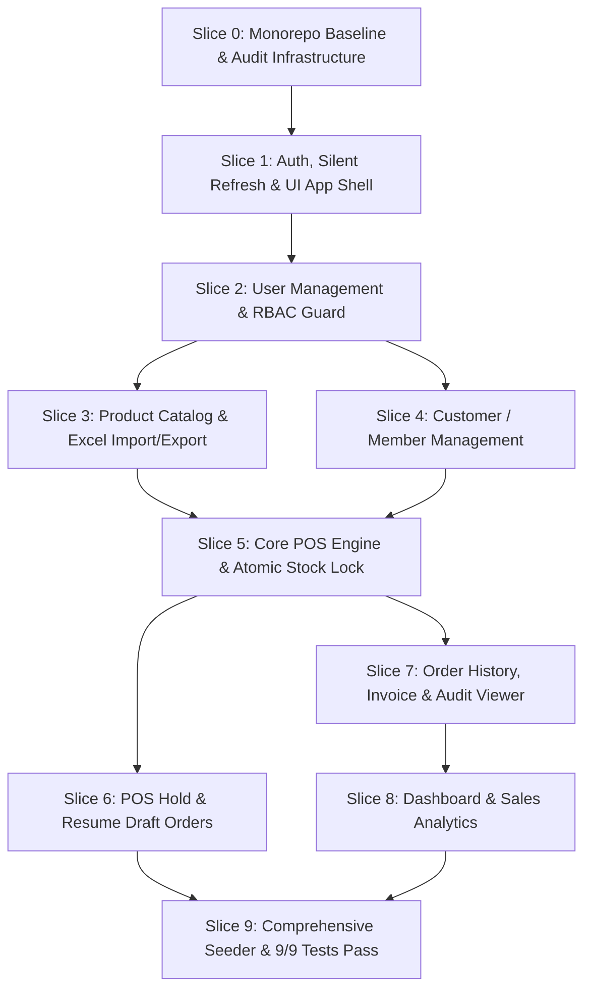

# SPRINT PLAN & VERTICAL SLICE IMPLEMENTATION ROADMAP
## Titipin — Sistem Point of Sale (POS) & Order Management

| Metadata | Keterangan |
| :--- | :--- |
| **Dokumen ID** | `SP-TITIPIN-001` |
| **Versi** | `1.1.0` |
| **Tanggal Efektif** | 27 Oktober 2026 |
| **Status** | 100% IMPLEMENTED & RELEASED (v1.0.0) |
| **Alur Kerja Git** | Git Flow (`main`, `develop`, `feature/slice-*` dengan auto-delete setelah merge) |
| **Metodologi** | 10 Vertical Slices (End-to-End per Business Capability) |
| **Dokumen Acuan** | `docs/product/PRD.md`, `docs/architecture/ARCHITECTURE.md`, `docs/architecture/DATA-MODEL.md`, `docs/api/openapi.yaml`, `docs/design/DESIGN-SYSTEM.md`, `docs/design/TOKENS.md`, `docs/design/COMPONENTS.md`, `docs/design/pages/*.md`, `docs/product/ACCEPTANCE-CRITERIA.md` |

---

## 1. STRATEGI IMPLEMENTASI & ATURAN HYGIENE GIT FLOW

### 1.1 Aturan Disiplin Git Flow (*Branch Hygiene & Tagging Rules*)
1. **Dilarang Commit Langsung ke `develop` atau `main`:** Seluruh pengerjaan irisan vertikal wajib membuat feature branch: `git checkout -b feature/slice-<number>-<slug>`.
2. **Penggabungan Non-Fast-Forward:** Seluruh merge ke `develop` wajib menggunakan flag `--no-ff` dengan pesan commit deskriptif: `git merge --no-ff feature/slice-... -m "merge: feature/slice-... into develop"`.
3. **Pembersihan Cabang (*Branch Deletion*):** Segera setelah feature branch sukses di-merge ke `develop`, cabang lokal tersebut wajib dihapus: `git branch -d feature/slice-...` agar repositori tetap bersih dan rapi.
4. **Milestone Tagging:** Setiap penutupan fase penting diberi Git Tag yang jelas (contoh: `v1.0.0-phase1`, `v1.0.0-phase2`, `v1.0.0` pada final release).

---

### 1.2 Diagram Ketergantungan Antar Slice

---

### 1.3 Matriks Ketertelusuran Lengkap (*Complete Traceability Matrix*)

| Slice ID | Nama Irisan Vertikal | Modul Domain | Tabel DB | Endpoint OpenAPI | UI Specs Terkait | Integration Test | Aturan Bisnis |
| :--- | :--- | :--- | :--- | :--- | :--- | :--- | :--- |
| **Slice 0** | Monorepo Baseline & Infra | `shared`, `core` | `audit_logs` (schema) | Global Error Response | [TOKENS.md](../design/TOKENS.md), [COMPONENTS.md](../design/COMPONENTS.md) | Setup verification | - |
| **Slice 1** | Auth, Session & App Shell | `auth` | `users` | `/api/auth/*` | [01-login.md](../design/pages/01-login.md), [02-app-shell.md](../design/pages/02-app-shell.md) | `TEST-06` | BR-007, BR-008, BR-015 |
| **Slice 2** | User Management & RBAC | `users` | `users` | `/api/users/*` | [06-users.md](../design/pages/06-users.md) | `TEST-08`, `TEST-09` | BR-010, BR-011, BR-015 |
| **Slice 3** | Product Catalog & Inventory | `products` | `products` | `/api/products/*` | [04-products.md](../design/pages/04-products.md) | `TEST-07` | BR-001, BR-006, BR-009 |
| **Slice 4** | Customer / Member Management | `customers` | `customers` | `/api/customers/*` | [05-customers.md](../design/pages/05-customers.md) | Customer CRUD verification | BR-006 |
| **Slice 5** | Core POS Engine & Stock Lock | `orders` | `orders`, `order_items`, `order_activity_logs` | `POST /api/orders` | [03-pos-checkout.md](../design/pages/03-pos-checkout.md) | `TEST-01`, `TEST-02`, `TEST-03`, `TEST-05` | BR-001..005, BR-013, BR-017 |
| **Slice 6** | POS Hold & Resume Drafts | `orders` | `draft_orders` | `/api/orders/hold`, `/api/orders/held*` | [03-pos-checkout.md](../design/pages/03-pos-checkout.md) | `TEST-04` | BR-012, BR-016, BR-017 |
| **Slice 7** | Order History & Audit Viewer | `orders`, `audit` | `orders`, `audit_logs` | `GET /api/orders/*`, `/api/audit-logs` | [07-orders-history.md](../design/pages/07-orders-history.md), [08-order-detail.md](../design/pages/08-order-detail.md), [09-audit-logs.md](../design/pages/09-audit-logs.md) | `TEST-09` (Audit RBAC) | BR-002, BR-014, BR-017 |
| **Slice 8** | Dashboard & Analytics | `dashboard` | Agregasi `orders`, `products` | `/api/dashboard/*` | [10-dashboard.md](../design/pages/10-dashboard.md) | `TEST-10` | BR-018, BR-019 |
| **Slice 9** | Seeder, Polish & Production Docker | Seluruh Sistem | 8 Tabel | Seluruh 23 Endpoint | Seluruh UI Pages | `TEST-01` s/d `TEST-09` (100% Pass) | NFR-DEV-01, Seluruh BR |

---

## 2. RINCIAN SETIAP VERTICAL SLICE

---

### SLICE 0: Monorepo Workspace, Shared Baseline & Audit Infrastructure
* **Tujuan:** Membangun fondasi monorepo Turborepo + pnpm, Docker Compose PostgreSQL lokal, lapisan Drizzle ORM, hook audit log awal, serta konfigurasi design tokens (OKLCH, rounded scale, glassmorphic recipes).
* **Target Branch:** `feature/slice-0-monorepo-baseline`
* **Tasks:**
  1. Inisialisasi root `pnpm-workspace.yaml`, `turbo.json`, dan root `package.json`.
  2. Setup `packages/shared`: konfigurasi TypeScript composite / `tsup`, package metadata, shared enums (`Role`, `Gender`).
  3. Setup `apps/backend`: NestJS 11+ bootstrap, konfigurasi environment Zod, PostgreSQL connection pool provider via Drizzle ORM.
  4. Setup skema Drizzle awal `src/database/schema/audit.schema.ts` dan service hook internal `AuditService` (agar modul selanjutnya langsung bisa mencatat audit write tanpa refactoring ulang).
  5. Setup `apps/frontend`: Next.js 15 App Router skeleton, Tailwind CSS v3/v4 dengan konfigurasi [TOKENS.md](../design/TOKENS.md) (`oklch` palette, `rounded-xl`, `rounded-2xl`, `rounded-3xl`, `glass-panel`, `canvas-texture` dot matrix), dan TanStack Query provider.
  6. Buat `docker-compose.yml` untuk PostgreSQL 16 database lokal.
* **Definition of Done (DoD):**
  * `pnpm install` dan `pnpm build` sukses di root.
  * `docker compose up -d` menyalakan database PostgreSQL lokal.
  * Backend NestJS berjalan di port 3001, Frontend Next.js berjalan di port 3000.
  * Branch `feature/slice-0-monorepo-baseline` di-merge ke `develop` dengan `--no-ff` lalu branch dihapus.

---

### SLICE 1: Autentikasi Pengguna, Silent Mutex Refresh & UI App Shell
* **Tujuan:** Mengamankan sistem dengan JWT ganda (Access Token in-memory + Refresh Token HttpOnly Cookie) dan menyediakan layout dashboard kaca yang kokoh.
* **Target Branch:** `feature/slice-1-auth-app-shell`
* **Spesifikasi UI:** [01-login.md](../design/pages/01-login.md), [02-app-shell.md](../design/pages/02-app-shell.md)
* **Tasks:**
  1. **Database:** Skema Drizzle `src/database/schema/users.schema.ts` (id uuid, email unique, password hash, role enum, refresh_token_hash, deleted_at).
  2. **Shared:** Zod schema untuk login, refresh, dan DTO `LoginResponse`, `UserItem`.
  3. **Backend (`auth` module):**
     * Endpoint `POST /api/auth/login`: validasi bcrypt/argon2id, hash refresh token ke DB, set HttpOnly cookie.
     * Endpoint `POST /api/auth/refresh`: verifikasi hash refresh token di DB, terbitkan access token baru.
     * Endpoint `POST /api/auth/logout`: kosongkan `refresh_token_hash = NULL` dan revoke cookie.
     * Endpoint `GET /api/auth/me`, `PATCH /api/auth/me`, `POST /api/auth/change-password`.
     * `JwtAuthGuard` berbasis Passport / NestJS Guard untuk validasi Bearer Token.
  4. **Frontend:**
     * Halaman `/login` dengan kartu kaca (`glass-panel rounded-3xl p-8`), form validasi Zod, alert error 401.
     * Axios Client dengan **Mutex Queue Interceptor** (menahan request paralel saat 401 dan auto-refresh token).
     * Protected Layout Shell `(dashboard)/layout.tsx`: Top Navbar (frosted glass, logo, status terminal, profil user, logout) dan Responsive Sidebar (`rounded-3xl`).
* **Automated Test:** `TEST-06` (Akses endpoint terproteksi tanpa token ditolak 401).
* **Definition of Done (DoD):** Login, silent auto-refresh, dan logout berfungsi penuh; layout shell ter-render rapi; branch di-merge ke `develop` dan dihapus.

---

### SLICE 2: Manajemen Pengguna Internal & RBAC Guard
* **Tujuan:** Menyelesaikan wewenang Admin untuk mendaftarkan staf, mereset password kasir, dan menonaktifkan akun kasir dengan pencabutan sesi instan.
* **Target Branch:** `feature/slice-2-user-management`
* **Spesifikasi UI:** [06-users.md](../design/pages/06-users.md)
* **Tasks:**
  1. **Shared:** Zod schema `CreateUserInput`, `ResetPasswordInput`.
  2. **Backend (`users` module):**
     * `RolesGuard` dan decorator `@Roles('ADMIN')`.
     * Endpoint `GET /api/users`: daftar seluruh staf/admin beserta role dan status aktif/nonaktif.
     * Endpoint `POST /api/users`: Admin mendaftarkan kasir/admin baru (`AC-USR-04`).
     * Endpoint `PATCH /api/users/:id/reset-password`: reset password kasir + `refresh_token_hash = NULL` (dengan Self-Guard).
     * Endpoint `DELETE /api/users/:id`: soft delete `deleted_at = NOW()` + `refresh_token_hash = NULL` secara atomik (dengan Self-Guard).
     * Catat seluruh aksi write ke `audit_logs`.
  3. **Frontend:**
     * Halaman `/users` (khusus Admin): Tabel staf kaca (`rounded-2xl`), modal Tambah Pengguna, modal Reset Password, dialog konfirmasi Nonaktifkan Akun.
     * Next.js Middleware route guard: Kasir ditolak saat mencoba membuka `/users`.
* **Automated Tests:**
  * `TEST-08`: Soft delete user memblokir login & silent refresh, histori transaksi tetap utuh.
  * `TEST-09`: Kasir mengakses `/api/users` ditolak 403 Forbidden.
* **Definition of Done (DoD):** Admin dapat CRUD user; self-guard aktif; tes TEST-08 dan TEST-09 lulus; branch di-merge ke `develop` dan dihapus.

---

### SLICE 3: Katalog Produk, Inventaris & Import/Export Excel
* **Tujuan:** Mengelola data master produk, validasi harga dan stok, ekspor `.xlsx`, serta impor massal idempoten.
* **Target Branch:** `feature/slice-3-product-catalog`
* **Spesifikasi UI:** [04-products.md](../design/pages/04-products.md)
* **Tasks:**
  1. **Database:** Skema Drizzle `src/database/schema/products.schema.ts` (`stock >= 0`, `price > 0`, soft delete `deleted_at`, index pencarian).
  2. **Shared:** Zod schema `CreateProductInput`, `UpdateProductInput`, DTO `ProductItem`.
  3. **Backend (`products` module):**
     * CRUD produk: `GET /api/products` (search, sort, pagination), `POST /api/products`, `GET /api/products/:id`, `PUT /api/products/:id`, `DELETE /api/products/:id` (soft delete).
     * `GET /api/products/export`: generate file Excel `.xlsx` menggunakan `exceljs`.
     * `POST /api/products/import`: upload multipart file spreadsheet, parsing idempoten berbasis `product_code` (upsert: insert jika baru, update jika ada).
     * Hook pencatatan mutasi ke `audit_logs`.
  4. **Frontend:**
     * Halaman `/products`: Data Table kaca (`rounded-2xl`), toolbar pencarian & urutan, modal Tambah/Edit Produk.
     * Dialog modal Import Spreadsheet dengan drag-and-drop zone (`rounded-3xl`) dan ringkasan hasil (*Total, Inserted, Updated, Failed*).
     * Tombol unduh file Excel.
* **Automated Test:** `TEST-07` (Integritas soft delete produk dan import idempoten).
* **Definition of Done (DoD):** CRUD produk berfungsi; import/export Excel berjalan lancar; tes TEST-07 lulus; branch di-merge ke `develop` dan dihapus.

---

### SLICE 4: Manajemen Pelanggan (Member Toko)
* **Tujuan:** Mengelola profil pelanggan terdaftar toko (member) sebagai opsi identifikasi pembeli di POS.
* **Target Branch:** `feature/slice-4-customer-management`
* **Spesifikasi UI:** [05-customers.md](../design/pages/05-customers.md)
* **Tasks:**
  1. **Database:** Skema Drizzle `src/database/schema/customers.schema.ts` (uuid PK, `customer_name`, `customer_address`, `gender`, `birth_date`, `phone`, soft delete `deleted_at`).
  2. **Shared:** Zod schema `CreateCustomerInput`, `CustomerItem`.
  3. **Backend (`customers` module):**
     * `GET /api/customers` (search nama, pagination), `POST /api/customers`, `GET /api/customers/:id`, `PUT /api/customers/:id`, `DELETE /api/customers/:id`.
     * Hook pencatatan mutasi ke `audit_logs`.
  4. **Frontend:**
     * Halaman `/customers`: Data Table member (`rounded-2xl`), modal pendaftaran member baru (`rounded-3xl`), form edit profil.
* **Definition of Done (DoD):** Pendaftaran dan listing member berfungsi; data siap di-lookup di POS; branch di-merge ke `develop` dan dihapus.

---

### SLICE 5: Core POS Checkout Engine & Atomic Concurrency Stock Locking (Jantung Sistem)
* **Tujuan:** Menuntaskan transaksi penjualan POS secara atomik, aman dari *race condition* stok, dengan kalkulasi harga di server dan snapshot harga historis.
* **Target Branch:** `feature/slice-5-core-pos-engine`
* **Spesifikasi UI:** [03-pos-checkout.md](../design/pages/03-pos-checkout.md)
* **Tasks:**
  1. **Database:** Skema Drizzle `src/database/schema/orders.schema.ts`: tabel `orders` (`total_amount numeric(14,2)`), tabel `order_items` (`unit_price numeric(12,2)` snapshot), tabel `order_activity_logs`.
  2. **Shared:** Zod schema `CreateOrderInput` (`customer_id` nullable, `items: [{ product_id, quantity }]`).
  3. **Backend (`orders` module):**
     * Eksekusi `POST /api/orders` di dalam `db.transaction`:
       1. Lock baris produk terpilih via `SELECT ... FOR UPDATE` (`ProductsService.lockAndDeductStock(tx, items)`).
       2. Verifikasi kecukupan stok seluruh item. Jika ada item yang stoknya kurang, batalkan transaksi dan lemparkan error format standar `errors["items.X.quantity"]`.
       3. Hitung harga dan subtotal murni di server berdasarkan data master produk.
       4. Potong kuantitas stok di tabel `products`.
       5. Generate nomor nota `INV-YYYYMMDD-XXXX`.
       6. Insert ke `orders` dan `order_items` (snapshot `unit_price`).
       7. Insert log aktivitas ke `order_activity_logs` (`ORDER_CREATED`).
       8. Hook ke `audit_logs`.
  4. **Frontend:**
     * Halaman kasir `/pos`:
       * Split screen: Grid produk cepat (kiri) + Keranjang kasir sticky drawer (kanan).
       * Pemilih Pelanggan: Switch "Pelanggan Umum (Walk-in)" vs Cari Member.
       * Keranjang: Quantity stepper, kalkulasi subtotal, total besar Rp.
       * Modal konfirmasi pembayaran tunai + kalkulasi uang kembalian.
       * Modal nota struk belanja siap cetak (*thermal friendly*).
       * Highlight merah spesifik pada item jika stok kurang saat checkout.
* **Automated Tests:**
  * `TEST-01`: Buat order member sukses (stok terpotong, invoice terbit, total valid).
  * `TEST-02`: Buat order walk-in sukses (`customer_id = null`, label Pelanggan Umum).
  * `TEST-03`: Stok tidak mencukupi (seluruh transaksi rollback, stok utuh).
  * `TEST-05`: Validasi input gagal (kuantitas negatif / payload korup ditolak 422).
* **Definition of Done (DoD):** Checkout POS atomik berjalan; race condition dicegah oleh row lock; seluruh tes TEST-01, TEST-02, TEST-03, TEST-05 lulus; branch di-merge ke `develop` dan dihapus.

---

### SLICE 6: Hold & Resume Transaksi POS (Draft Orders Isolation)
* **Tujuan:** Mengizinkan kasir menahan antrean keranjang tanpa memotong stok dan melanjutkannya kembali tanpa mencemari tabel `orders`.
* **Target Branch:** `feature/slice-6-pos-hold-orders`
* **Spesifikasi UI:** [03-pos-checkout.md](../design/pages/03-pos-checkout.md)
* **Tasks:**
  1. **Database:** Skema Drizzle `src/database/schema/orders.schema.ts`: tabel `draft_orders` dengan constraint `UNIQUE user_id` (1 kasir max 1 draft).
  2. **Backend (`orders` module):**
     * `POST /api/orders/hold`: simpan keranjang aktif ke `draft_orders` tanpa potong stok. Ditolak 422 jika kasir sudah punya 1 draft aktif.
     * `GET /api/orders/held`: ambil draft milik kasir yang sedang login.
     * `DELETE /api/orders/held`: buang (discard) draft.
     * `POST /api/orders/held/finalize`: jalankan transaksi finalisasi atomik (lock stok $\to$ potong stok $\to$ insert `orders` $\to$ hapus draft $\to$ catat log `ORDER_FINALIZED`).
  3. **Frontend:**
     * Tombol "Tahan Transaksi (Hold)" pada keranjang kasir.
     * Badge status draft aktif di Top Navbar kasir.
     * Modal Transaksi Tertahan: opsi "Lanjutkan Transaksi" (muat ulang ke keranjang) atau "Buang Transaksi".
* **Automated Test:** `TEST-04` (Hold transaksi ke `draft_orders` tanpa potong stok, lalu finalize ke `orders`).
* **Definition of Done (DoD):** Hold order berfungsi; constraint 1 kasir max 1 draft aktif terbukti; tes TEST-04 lulus; branch di-merge ke `develop` dan dihapus.

---

### SLICE 7: Riwayat Penjualan, Rincian Nota & Audit Trail Terpusat
* **Tujuan:** Menyediakan pencarian riwayat transaksi dengan filter tanggal/pelanggan dan transparansi audit mutasi data sistem bagi Admin.
* **Target Branch:** `feature/slice-7-history-audit`
* **Spesifikasi UI:** [07-orders-history.md](../design/pages/07-orders-history.md), [08-order-detail.md](../design/pages/08-order-detail.md), [09-audit-logs.md](../design/pages/09-audit-logs.md)
* **Tasks:**
  1. **Backend:**
     * `GET /api/orders`: listing riwayat dengan filter rentang tanggal (`from`, `to`), filter `customer_id`, dan paginasi.
     * `GET /api/orders/:id`: rincian invoice lengkap dengan item snapshot dan timeline kejadian `order_activity_logs`.
     * `GET /api/audit-logs`: listing audit mutasi data (Admin Only, filter user, action, entity, tanggal).
  2. **Frontend:**
     * Halaman `/orders`: Tabel riwayat transaksi dengan filter date picker dan filter member.
     * Halaman `/orders/[id]`: Rincian invoice resmi dengan timeline log aktivitas transaksi.
     * Halaman `/audit-logs` (Admin Only): Tabel audit trail kaca, modal inspeksi diff JSON payload (*before & after*).
* **Automated Test:** `TEST-09` (Kasir mengakses `/api/audit-logs` ditolak 403 Forbidden).
* **Definition of Done (DoD):** Riwayat order dan detail invoice ter-render dengan timeline log; audit trail admin berfungsi; tes TEST-09 lulus; branch di-merge ke `develop` dan dihapus.

---

### SLICE 8: Dashboard Analitik Penjualan & Monitoring Inventaris
* **Tujuan:** Menyajikan laporan finansial, tren penjualan harian, perbandingan produk terlaris vs lesu, dan alert stok kritis.
* **Target Branch:** `feature/slice-8-dashboard-analytics`
* **Spesifikasi UI:** [10-dashboard.md](../design/pages/10-dashboard.md)
* **Tasks:**
  1. **Backend (`dashboard` module):**
     * `GET /api/dashboard/summary?period=daily|monthly|quarterly`: hitung total omset (Rp), total transaksi, top 5 produk terlaris, bottom 5 produk lesu (produk 0 penjualan diprioritaskan di atas), dan daftar produk aktif stok $< 5$.
     * `GET /api/dashboard/trend?period=daily|monthly|quarterly`: data harian omset dan jumlah transaksi untuk grafik tren.
  2. **Frontend:**
     * Halaman `/dashboard`:
       * Switch pill periode: "Hari Ini", "Bulan Ini", "Kuartal Ini".
       * 4 Kartu KPI Metrik kaca (`glass-card rounded-2xl`).
       * Grafik tren harian interaktif (Recharts Area / Bar Chart).
       * Panel komparasi Top 5 Best Sellers vs Bottom 5 Slow Movers.
       * Widget peringatan stok kritis ($< 5$).
* **Definition of Done (DoD):** Filter periode harian, bulanan, dan kuartalan akurat; grafik tren ter-render responsif; kartu metrik dan alert stok kritis berfungsi; branch di-merge ke `develop` dan dihapus.

---

### SLICE 9: Seeder Realistis, Full Test Suite 9/9 & Production Docker Orchestration
* **Tujuan:** Menuntaskan database seeder yang kaya data, memverifikasi seluruh 9 automated integration test lulus 100%, dan memastikan aplikasi siap dijalankan di production dalam $\le 6$ perintah CLI.
* **Target Branch:** `feature/slice-9-seeder-prod-release`
* **Tasks:**
  1. **Seeder Script (`src/database/seed.ts`):**
     * Akun Default: 1 Admin (`admin@titipin.id`), 1 Kasir (`kasir@titipin.id`).
     * Minimal 20 produk katalog aktif dengan variasi harga dan stok (beberapa stok $< 5$).
     * Minimal 15 data pelanggan member aktif.
     * Minimal 30 data order transaksi historis yang tersebar realistis dalam 30 hari terakhir.
     * Entri seeder tercatat pada `order_activity_logs` dan `audit_logs`.
  2. **Automated Integration Tests (`pnpm test`):**
     * Verifikasi kelulusan 100% pada seluruh 9 skenario uji integrasi (`TEST-01` s/d `TEST-09`).
  3. **Production Containerization:**
     * Multi-stage `Dockerfile` untuk backend NestJS.
     * Standalone build `Dockerfile` untuk frontend Next.js 15.
     * `docker-compose.prod.yml` untuk orkestrasi 3 service (backend, frontend, postgres).
  4. **Dokumentasi README Master:**
     * Panduan setup dari *git clone* hingga aplikasi berjalan dalam maksimal 6 perintah CLI.
* **Definition of Done (DoD):**
  * `pnpm test` menghasilkan 9/9 test PASS tanpa error.
  * `docker compose -f docker-compose.prod.yml up --build` berjalan lancar.
  * Branch di-merge ke `develop`, lalu `develop` di-merge ke `main`, dan ditandai Git Tag `v1.0.0`.
